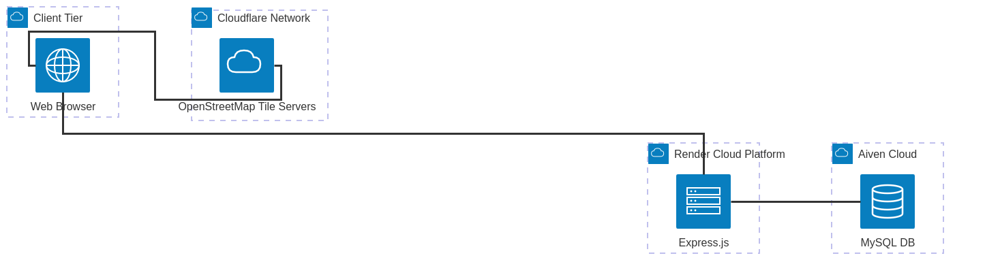

# Deployment Overview

Adamas2Aurum is deployed as a **split-origin** system (frontend and backend on different domains, database managed separately) but also supports **same-origin local** development where the backend serves the frontend on one port.

## Deployment Targets

| Component | Host | URL | Branch | How deployed |
|-----------|------|-----|--------|--------------|
| **Frontend** | Cloudflare Workers (static assets) | `https://website.adamas2aurum.workers.dev` | `main` | Gitea Action `frontend-deploy.yml` runs `npx wrangler deploy --assets=./app/src/frontend --name website` on push to `main` |
| **Backend** | Render | `https://adamas2aurum.onrender.com` | `dev` (mirrored to GitHub) | Render watches GitHub mirror `Busisiwe-Mnguni/Adamas2Aurum-backend-deployment` (`dev`), auto-deploys on mirror sync |
| **Database** | Aiven MySQL 8.4 | `aiven.io` managed (`a2adb`) | — | No deploy; `initialize_database()` runs `CREATE TABLE IF NOT EXISTS` + `ensure_curation_schema()` on every boot |
| **Documentation** | GitHub Pages | `https://pumelela1.github.io/Adamas2Aurum-Documentation/` | `main` (docs repo) | GitHub Actions workflow `.github/workflows/main.yml` builds Docusaurus and deploys to Pages on push to `main` |

Source of truth is **Gitea** `sdp.ms.wits.ac.za/404-found-us/Adamas2Aurum` (SSO). Render cannot reach Gitea directly, so a `--mirror` to GitHub is maintained (see `implementation/backend.md` mirroring steps).

## Diagram

- `Gitea → GitHub mirror → Render` (backend)
- `Gitea → Cloudflare Workers` (frontend)
- Both → Aiven MySQL
- Gitea Actions runners: `test.yml` (unit), `coverage.yml` (coverage + badges + artifact, Node 20), `format-check.yml` (Prettier) — see `deployment/ci.md`.

## Configuration

All env vars, DB pool, CORS, secrets, and destructive flags are documented in [`configuration.md`](./configuration.md) (env table, idempotent schema, `SEED_DB=false` warning).

## Verification

- Local: `curl http://localhost:3000/api/health` → `{success:true, tables:[...]}`.
- Remote: same `/api/health` on Render URL; Cloudflare Workers serves `app/src/frontend` statically at `website.adamas2aurum.workers.dev`.
- CI: `coverage.yml` uploads `coverage/lcov-report/` artifact (14 days) and commits `badges/` SVGs.

Further details: [Local + Remote Deployment](./deployment.md) and [CI/CD](./ci.md).
